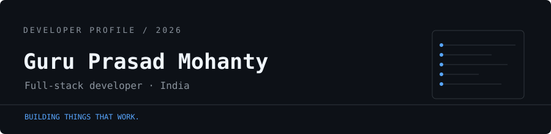
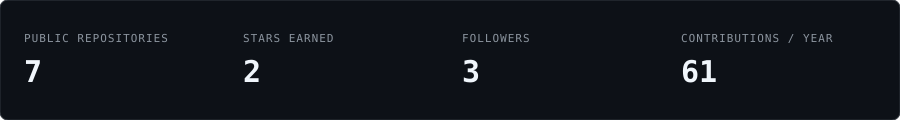
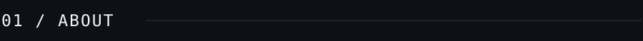
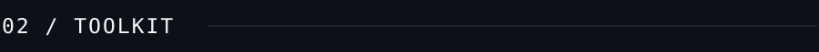
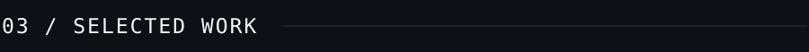
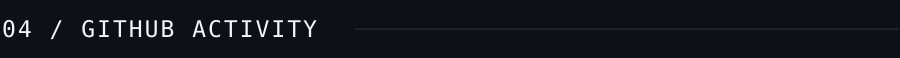
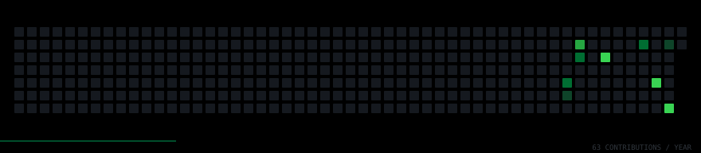
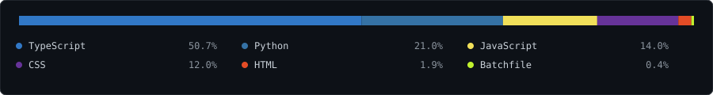
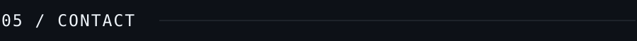

 

<a href="https://github.com/SlayingAlways">github</a> &nbsp;·&nbsp;
<a href="https://instagram.com/guru.jpg">instagram</a> &nbsp;·&nbsp;
<a href="mailto:workwithgurupm@gmail.com">email</a>

  

> Guru Prasad Mohanty. Developer from India.
> Interested in building useful software, exploring systems, and turning rough ideas into working products.

I work across frontend and application development, with an interest in clean interfaces, practical tooling, and thoughtful engineering. I enjoy learning how things work under the hood just as much as shipping the final product.

Currently exploring **React, JavaScript, system design, and Linux**. Usually found switching between Windows and CachyOS, building something, or debugging one more thing.

javascript &nbsp;·&nbsp; typescript &nbsp;·&nbsp; python &nbsp;·&nbsp; react &nbsp;·&nbsp; react native &nbsp;·&nbsp; expo &nbsp;·&nbsp; node.js &nbsp;·&nbsp; vite &nbsp;·&nbsp; git &nbsp;·&nbsp; linux

**[Termify](https://github.com/SlayingAlways/Termify)** &nbsp;·&nbsp; terminal · audio · Python · JavaScript 
A Spotify-inspired music player that lives in the terminal. Search for music and play audio directly from a keyboard-first interface.

**[VOIDGPT](https://github.com/SlayingAlways/VOIDGPT)** &nbsp;·&nbsp; Next.js · React · OAuth 
A web chat application exploring a ChatGPT sign-in flow through an OAuth bridge, with a streaming chat interface.

**[FitFolks](https://github.com/SlayingAlways/FitFolks)** &nbsp;·&nbsp; React Native · Expo · TypeScript 
A fitness app concept focused on accessible workouts, regional nutrition, activity tracking, and culturally relevant experiences.

**[Portfolio](https://github.com/SlayingAlways/Portfolio)** &nbsp;·&nbsp; React · frontend 
A personal portfolio website for presenting projects, skills, and contact information.

**[openai-oauth-in-localhost](https://github.com/SlayingAlways/openai-oauth-in-localhost)** &nbsp;·&nbsp; OAuth · developer tooling 
An exploration of running an OpenAI OAuth integration locally.

 

 
Statistics are generated from public GitHub data and refreshed daily by GitHub Actions.

<a href="https://instagram.com/guru.jpg" style="display:inline-block; padding:10px 24px; background:linear-gradient(45deg,#833AB4,#FD1D1D,#FCB045); color:#fff; border:none; border-radius:25px;text-decoration:none; font-weight:bold;">Instagram</a>
<a href="mailto:workwithgurupm@gmail.com" style="display:inline-block;padding:10px 24px;background:#EA4335;color:#fff;border:none;border-radius:25px;text-decoration:none;font-weight:bold;">Gmail</a>

  
Built with curiosity, patience, and a terminal.

